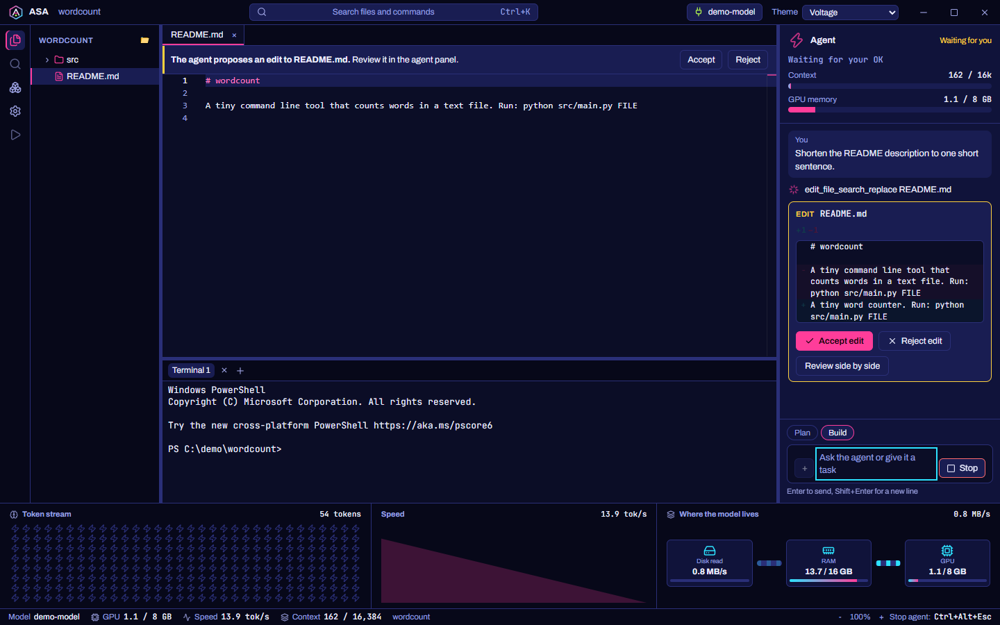
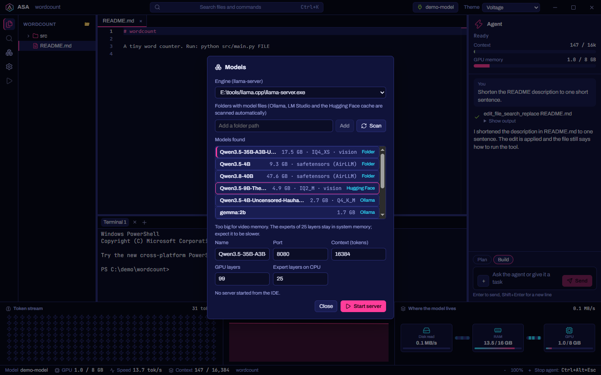
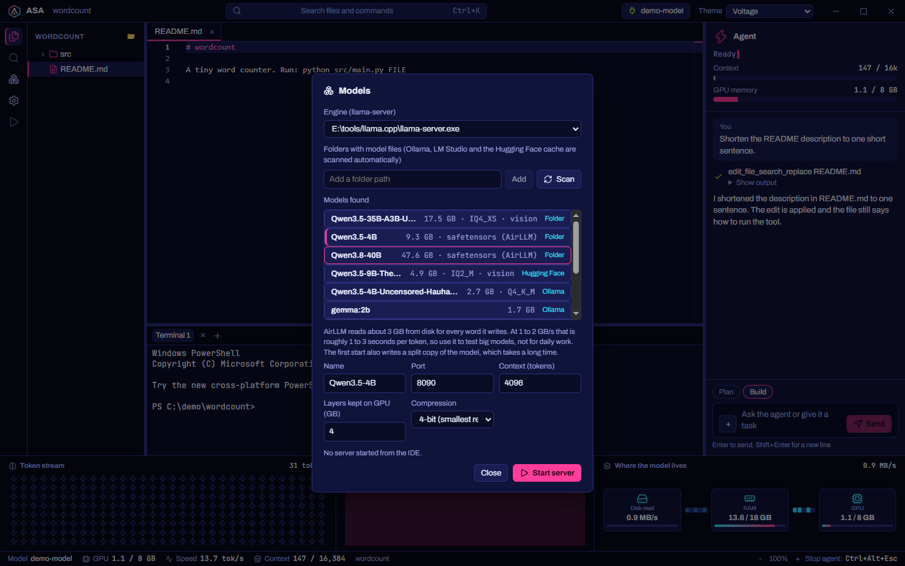
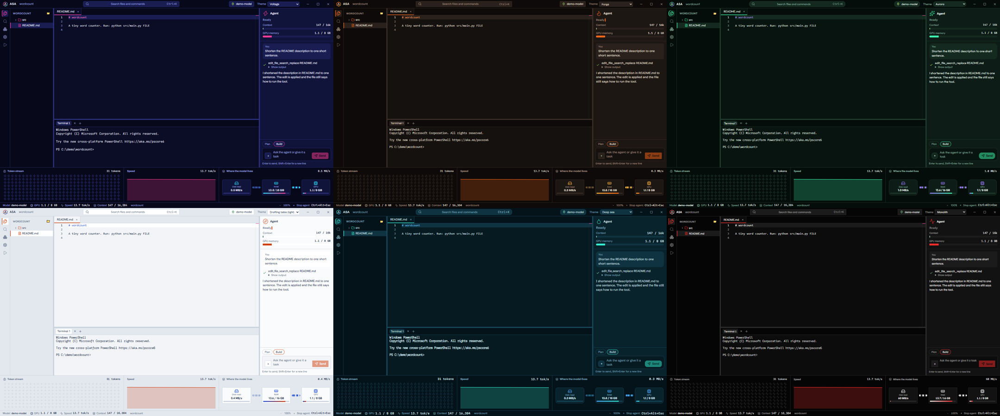

<div align="center">

# ASA Agentic Super AI IDE

**A coding IDE with an AI agent that runs entirely on your own machine.**
No cloud, no account, no API bill. Bring a GGUF file or a Hugging Face model folder, press Start, and work.

[](LICENSE)




</div>

> The screenshots on this page were taken from the real IDE, using a scripted stand-in model so the output is repeatable.
> They show the interface, not model quality or speed (the tok/s in the engine strip is the stand-in's scripted pace). Real speeds are in [Measured speeds](#measured-speeds).

## Why this exists

Strong open models keep getting bigger, and most developers have a mid-range GPU. This project is an IDE built around that limit.
It started on an RTX 4060 with 8 GB of video memory and 16 GB of RAM, and it is designed to stay useful there: it picks sensible
launch settings for the model you choose, shows where the model's weights live while it runs, and keeps the agent safe by
asking before it changes anything.

## What you get

- **An editor you already know.** Monaco editor, a file tree, search, a command palette (`Ctrl+K`) and a real terminal.
- **An agent that edits your code, with you in charge.** It reads files, proposes SEARCH/REPLACE edits and shows each one as a
  diff. Nothing is written until you press **Accept**. Plan mode lets it look but not touch.
- **A Models dialog for both kinds of local models.** It finds your models, suggests settings and starts the server for you.
- **A live engine strip.** Tokens per second, a stream of generated tokens, and where the model sits right now:
  disk read speed, RAM and GPU memory.
- **Six themes**, from Voltage (default) to a light Drafting table.
- **Fully local.** The agent talks to a server on `localhost`. Any OpenAI-compatible server works.

## Run big models on ordinary hardware

The Models dialog (the model chip in the title bar, or the boxes icon in the left bar) scans your drives, Ollama, LM Studio
and the Hugging Face cache, and lists everything it finds with its size and quantization.

### GGUF files with llama.cpp

Best for daily use. The IDE reads the GGUF header (layers, experts, context length) and your GPU memory, then suggests settings.
For mixture-of-experts models too big for the GPU, it keeps the attention layers on the GPU and moves some expert layers to
system memory, so a 35B model can run on 8 GB of VRAM.



### Safetensors folders with AirLLM

For trying models far larger than your GPU or RAM. AirLLM streams one layer at a time from disk, so it is slow, and the
dialog says how slow in plain words before you start. Use it to test a big model, not for daily work.



Both start from the same dialog, show the server log while the model loads, and connect the IDE when the server reports ready.
The agent does not care which one is behind the endpoint.

|  | GGUF files | Hugging Face safetensors folders |
|---|---|---|
| Engine | [llama.cpp](https://github.com/ggml-org/llama.cpp) `llama-server` | [AirLLM](https://github.com/lyogavin/airllm) through `tools/airllm-server` |
| Best for | Daily use. Experts of big mixture-of-experts models can live in system memory | Testing models much bigger than your hardware, at a large cost in speed |
| Suggested settings | From the GGUF header and your GPU memory | A plain-words speed estimate |
| Setup | Put `llama-server` on your `PATH` or let the dialog find it | See [tools/airllm-server/README.md](tools/airllm-server/README.md) |

## Measured speeds

Everything here was measured on one machine: RTX 4060 8 GB, Ryzen 5 5600X, 16 GB RAM, NVMe drive. Your numbers will differ.

| Model | Setting | Generation |
|---|---|---|
| Qwen3.6-35B-A3B Q4 (23 GB), file in the OS cache | 32 expert layers on CPU, 12 threads | **15.4 tok/s** |
| Qwen3.6-35B-A3B Q4 (23 GB), first run, file not cached | 40 expert layers on CPU | 3.5 tok/s |
| gpt-oss-120b MXFP4 (65 GB) | 33 expert layers on CPU | 1.4 tok/s |
| Qwen3.5-4B through AirLLM, 4-bit | layers streamed from disk | about 1.2 s per token |

What limits the speed: for models bigger than RAM, the GPU waits for the disk. During the 120B runs the GPU was busy 16 to 33%
of the time, and the drive delivered 0.3 to 0.5 GB/s although it can read 1.9 GB/s in long sequential reads. Memory-mapped loading
reads in small scattered pieces. The full tables, the drive test and the list of things still to try are in
[docs/PROJECT-PLAN.md](docs/PROJECT-PLAN.md) (sections 3 and 7).

## Themes



## Get started

You need Windows 10 or 11, [Rust](https://rustup.rs), Node.js, and the WebView2 runtime (included in Windows 11).

```bash
git clone https://github.com/ElMoorish/AgenticSuperAI-IDE.git
cd AgenticSuperAI-IDE
cargo build -p agent-core --release
cd apps/shell
npm install
npm run tauri dev
```

Then open the Models dialog, pick a model and press **Start server**. Or point **Settings** at any OpenAI-compatible endpoint
you already run (Ollama works as is).

Build an installer with `npm run tauri build` in `apps/shell`.

## How it is built

| Path | What |
|---|---|
| `apps/shell` | The IDE: Tauri v2, React, Monaco, xterm. `src-tauri` is the thin command layer, `src` is the interface |
| `crates/agent-core` | The agent, in Rust. JSON-RPC over stdio. Plan and Build modes, tool-call repair, a loop breaker, a VRAM budget check, streaming client |
| `crates/ide-host` | The host library with no UI dependency: workspace sandbox, atomic file writes, terminals, file watcher, settings, crash recovery, model finder and launcher |
| `tools/airllm-server` | An OpenAI-compatible server that runs safetensors models with AirLLM |
| `extension/` | A thin VS Code extension that starts the same agent |
| `config/`, `scripts/` | Launch scripts and the benchmark and test harnesses |
| `docs/` | Project plan with all measurements, architecture documents, manual test checklist |

### How the agent stays safe

- Every file path is checked against the open workspace folder. The agent cannot read or write outside it.
- Edits are applied through the editor only after you accept them, and written atomically.
- Shell commands go through a policy: known safe commands run, unknown ones ask first, destructive ones and shell operators are refused.
- Broken tool calls from small models are repaired, and a loop guard stops an agent that repeats itself.

## Develop and test

```bash
cargo test --workspace            # host, agent and end-to-end tests (scripted model, real agent process)
cd apps/shell && npm test         # interface tests
python scripts/smoke.py           # agent against a mock model and a fake editor, no GPU needed
python scripts/live.py [model] [url]   # 11 real scenarios against a local model with real cargo (optional)
```

Manual checks on a real machine and model: [docs/shell-checklist.md](docs/shell-checklist.md).

## Roadmap

Not done yet: incremental diagnostics through a language server, a code index, comparing compile errors before and after an edit,
and a tier that pages mixture-of-experts weights more cleverly than memory mapping (the measurements above are the motivation).
The plan, the open questions and what we intend to publish are in [docs/PROJECT-PLAN.md](docs/PROJECT-PLAN.md).

## License

[MIT](LICENSE)
